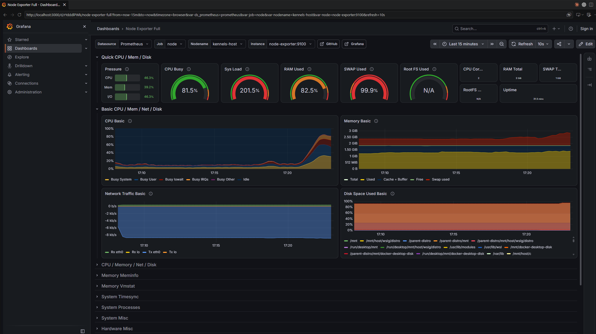
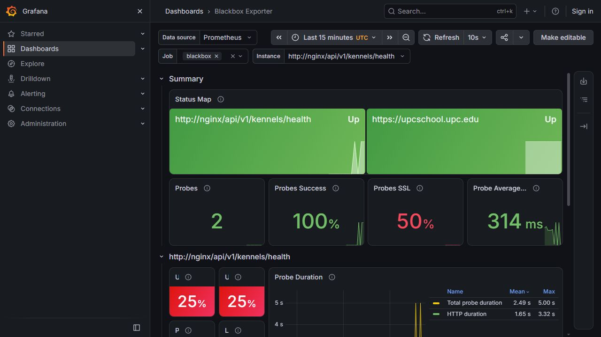

# Memoria Laboratorio 8.5 - Distributed Tracing

## ¿De qué trata este laboratorio?

Este laboratorio practica la observabilidad distribuida con el stack `LGTM` de Grafana (`Tempo` + `Prometheus` + `Grafana`) y [OpenTelemetry](https://opentelemetry.io/). Primero se exploran trazas sintéticas generadas con [`xk6-client-tracing`](https://github.com/grafana/xk6-client-tracing) (parte introductoria, no entregable) y después se instrumenta una aplicación real — una API de gestión de perreras (`kennels`) compuesta por tres microservicios Node.js (`kennels`, `dogs`, `inventory`) — con autoinstrumentación de OpenTelemetry, para visualizar sus trazas, el service graph y localizar un error intermitente en el servicio `dogs`.

## Estado de la entrega

| Parte | Estado | Detalle |
|---|---|---|
| Toma de contacto con las trazas (parte 1) | ✅ Realizada (no es entregable) | Stack LGTM + `xk6-client-tracing` desplegado y explorado localmente |
| Stack de observabilidad (Alloy + Tempo + Prometheus + Grafana) | ✅ Completo | `docker-compose.obs.yml`, `obs/config.alloy`, `obs/tempo.yaml`, datasources de Prometheus y Tempo provisionados |
| Instrumentación OpenTelemetry (`kennels` / `dogs` / `inventory`) | ✅ Completo | Autoinstrumentación con `@opentelemetry/auto-instrumentations-node`; trazas visibles en Tempo; service graph muestra `kennels → dogs` y `kennels → inventory` |
| Captura de la traza de error de `dogs` (punto 2.12, entregable) | ✅ Entregado | Ver capturas más abajo |
| Load testing con K6 (puntos 3.1-3.3) | ✅ Completo | Ver análisis y datos más abajo |
| Reto 1 — `node_exporter` + dashboard "Node Exporter Full" | ✅ Completo | Ver detalle más abajo |
| Reto 2 — `blackbox-exporter` + dashboard de sondas HTTP | ✅ Completo | Ver detalle más abajo |

## Instrumentación y traza de error (puntos 2.9 – 2.12)

Se añadieron `@opentelemetry/api` y `@opentelemetry/auto-instrumentations-node` a los tres servicios (`services/*/package.json`), cargando la autoinstrumentación con `node --require @opentelemetry/auto-instrumentations-node/register` en el arranque y configurando en `docker-compose.yml` las variables `OTEL_TRACES_EXPORTER=otlp`, `OTEL_EXPORTER_OTLP_ENDPOINT=http://alloy:4317` y `OTEL_EXPORTER_OTLP_PROTOCOL=grpc` para cada servicio.

El servicio `dogs` falla aleatoriamente (~70% de las peticiones) en su handler `GET /` (`services/dogs/src/index.js`), devolviendo un `500`. Al consultar las trazas en Tempo (Explore → Tempo → TraceQL `{resource.service.name="kennels" && status=error}`) se observa cómo ese error se origina en `dogs` y se propaga hasta la llamada saliente que hace `kennels` al pedirle el nombre de un perro.

**Jerarquía completa de la traza**: se ve la petición raíz `kennels GET /` llamando en paralelo a `inventory` (ok) y dos veces a `dogs` — una de las llamadas (`kennels GET (4.2ms)` → `dogs GET / (1.44ms)`) queda marcada en rojo, mientras que la otra llamada a `dogs` en la misma traza se completa con éxito:

**Detalle del span con el error**: al abrir el span rojo de `dogs` se confirma el fallo exacto — `http.status_code: 500`, `http.target: "/?id=1"`, `Status: error`:

## Load testing (puntos 3.1-3.3)

Se definió `obs/load_test.js` con K6, generando tráfico contra `http://nginx/api/v1/kennels` (3 peticiones por iteración, `id=0,1,2`). Por practicidad se usó una versión reducida del patrón de carga propuesto en el enunciado (rampa de 30s hasta 30 VUs + 2 min sostenido a 15 VUs, en vez de 1 min + 30 min), con la misma metodología. El resultado completo del run y las métricas internas quedan en [`obs/load_test_results.txt`](./obs/load_test_results.txt).

El pico de tráfico generado se aprecia en Prometheus con la query `rate(traces_service_graph_request_total{server="dogs"}[1m])`:

**¿Cuál es el ratio de fallos en el microservicio `dogs`?**
A nivel HTTP externo (lo que ve K6 contra `nginx`/`kennels`), el `http_req_failed` es **0%** — `kennels` absorbe los fallos de `dogs` con un `try/catch` y responde igualmente `200` con `"Nameless Dog"` como fallback (ver `services/kennels/src/data.js`). El fallo real solo es visible a nivel interno: consultando las métricas de service graph que genera Tempo en Prometheus (`traces_service_graph_request_total` / `..._failed_total` con `client="kennels", server="dogs"`), de **13128** llamadas `kennels → dogs` **9262** fallaron, es decir, un **70.55%** — coincide con el `Math.random() < 0.7` inyectado en `services/dogs/src/index.js`. Esto demuestra por qué las trazas distribuidas son necesarias: un fallo de esta magnitud queda completamente oculto si solo se monitoriza el código de estado HTTP de cara al cliente.

**¿Cuántas peticiones por segundo se generaron con K6?**
**43.28 req/s** HTTP (`http_reqs: 6564` en ~2m30s), equivalentes a **14.43 iteraciones/s** (cada iteración hace 3 peticiones), con hasta 30 VUs concurrentes.

**¿Cuál es el cuello de botella de la aplicación?**
Comparando la latencia p95 por servicio (`histogram_quantile(0.95, traces_service_graph_request_server_seconds)`):

| Servicio | p95 |
|---|---|
| `inventory` | 194.6 ms |
| `dogs` | 181.5 ms |
| `kennels` | 379.2 ms |

La p95 de `kennels` (379 ms) es casi exactamente la **suma** de las p95 de `inventory` y `dogs` (195 + 181 ≈ 376 ms), no el máximo de ambas. El motivo está en `services/kennels/src/data.js`: `kennels` primero hace `await getInventory(id)` y **solo después** lanza en paralelo (`Promise.all`) las llamadas a `getDogDetails` por cada perro. Como la llamada a `inventory` bloquea el inicio de las llamadas a `dogs`, la latencia total es aproximadamente aditiva en vez de estar acotada por el servicio más lento. **El cuello de botella es esta orquestación secuencial en `kennels`**, no el rendimiento individual de `dogs` o `inventory` — lanzar ambas llamadas en paralelo reduciría la p95 de ~380 ms a ~195 ms.

## Reto 1 — node_exporter y dashboard Node Exporter Full

**Decisión de diseño.** El enunciado ofrece dos opciones: desplegar `node_exporter` como contenedor o usar el exporter integrado de Alloy (`prometheus.exporter.unix`). Se eligió el **contenedor oficial** (`prom/node-exporter:v1.9.1`) por tres motivos: sigue el mismo patrón que `blackbox-exporter` (un exporter por servicio, scrapeado por Prometheus); mantiene Alloy centrado en su función de colector OTLP de trazas, sin mezclar responsabilidades; y la configuración de scraping queda en un único sitio (`obs/prometheus.yml`), lo que facilita depurar desde *Status → Targets*.

**Despliegue** (`docker-compose.obs.yml`, red `kennels_net`):

- El `/proc`, el `/sys` y la raíz `/` del host se montan en **solo lectura** dentro del contenedor (`/host/proc`, `/host/sys`, `/rootfs`) y se indican a `node_exporter` con `--path.procfs`, `--path.sysfs` y `--path.rootfs`. Así, las métricas de CPU, memoria, carga, disco y sistemas de ficheros describen el **host** y no el contenedor.
- `pid: host` para ver los procesos del host.
- Se excluyen del collector de filesystems los pseudo-sistemas de ficheros (`/sys`, `/proc`, `/dev`, `/host`, `/etc`), para no ensuciar los paneles de disco.
- `hostname: kennels-host`, para que el dashboard muestre un *Nodename* legible en lugar del ID del contenedor.
- **Limitación conocida:** el exporter se mantiene en `kennels_net` (sin `network_mode: host`) para que Prometheus lo alcance por nombre de servicio. Por eso las métricas de interfaces de red son las del *namespace* de red del contenedor. En Docker Desktop (Windows/macOS), el "host" es la VM Linux de Docker y no la máquina física.

**Scraping** (`obs/prometheus.yml`): nuevo job `node` contra `node-exporter:9100`, cada 15 s, con la etiqueta `cluster="docker-compose"`, igual que las sondas del reto 2.

**Validación** en *Explore → Prometheus*:

- `up{job="node"}` = 1: Prometheus scrapea el exporter.
- `node_uname_info{job="node"}`: una serie con `nodename="kennels-host"`.
- `100 * (1 - avg(rate(node_cpu_seconds_total{job="node",mode="idle"}[1m])))`: % de CPU del host. Sube de forma visible al lanzar el test de carga de K6.

**Dashboard**: importado desde *Dashboards → New → Import* con el ID [1860](https://grafana.com/grafana/dashboards/1860-node-exporter-full/) ("Node Exporter Full"), datasource `Prometheus`, *Job* `node`, *Nodename* `kennels-host`.

**Validación realizada** (2026-10-20, Docker Desktop sobre Windows): los 6 contenedores del stack de observabilidad en `running`; `up{job="node"}` = 1 y `node_uname_info` con `nodename="kennels-host"`. En Docker Desktop hubo que quitar la propagación `rslave` del montaje de `/`, porque la VM no monta `/` como *shared/slave* (`path / is mounted on / but it is not a shared or slave mount`). Como el exporter solo lee el sistema de ficheros, un montaje de solo lectura normal es suficiente.

Dashboard importado (ID 1860) con datos reales, capturado durante el test de carga de K6:

**Lectura de la captura:**

- **CPU**: en reposo, el uso está por debajo del 20 %. Al lanzar K6 (hacia las 17:21) sube a ~80 % (*CPU Busy* 81.5 %) y la carga del sistema llega al 201 % (*Sys Load*), es decir, unos 2 procesos esperando por cada uno de los 2 cores. El host está saturado de CPU durante la prueba.
- **Memoria**: la RAM usada llega al 82.5 % de 2 GiB y el swap al 99.9 %. La VM de Docker Desktop tiene poca memoria para todo el stack (aplicación + LGTM + K6), lo que también contribuye a la latencia observada en el load testing.
- **Pressure (PSI)**: CPU, memoria e I/O rondan el 40–46 %, lo que confirma que hay contención de recursos durante la prueba.
- **Red**: solo aparecen `eth0` y `lo` del contenedor, como se esperaba por la limitación descrita (el exporter no usa `network_mode: host`).
- **Root FS Used / RootFS Total = N/A**: en Docker Desktop, la raíz de la VM (WSL) no aparece como `mountpoint="/"`, sino como montajes de la distro (`/mnt/host/wslg/distro`, `/parent-distro`, `/mnt/docker-desktop-disk`…), que sí se ven en *Disk Space Used Basic*. En un host Linux nativo estos paneles mostrarían datos.

## Reto 2 — blackbox-exporter y sondas HTTP

Se añadió `blackbox-exporter` (`quay.io/prometheus/blackbox-exporter:v0.27.0`) al stack de observabilidad (`docker-compose.obs.yml`, red `kennels_net`), con el módulo `http_2xx` definido en `obs/blackbox.yml` (GET, timeout 5s, redirects habilitados). Para que Prometheus pudiera scrapearlo hizo falta crear `obs/prometheus.yml` (hasta entonces Prometheus corría sin `scrape_configs` propios, solo con `remote_write` desde Tempo) y montarlo en el servicio `prometheus`, con el job `blackbox` apuntando, vía *relabeling*, a:

- `http://nginx/api/v1/kennels/health` (nuevo endpoint añadido en `services/kennels/src/index.js`, antes del handler catch-all)
- `https://upcschool.upc.edu`

También fue necesario corregir `nginx/conf.d/default.conf` (`proxy_pass http://kennels;` en vez de `http://kennels/$uri$is_args$args;`), ya que la versión anterior introducía una doble barra en la ruta reenviada — pasaba desapercibido porque antes `kennels` solo tenía un handler catch-all (`app.use('/')`) que ignoraba el path, pero rompía el *routing* exacto que necesita `/api/v1/kennels/health`.

**Validación realizada** (reproducida de forma independiente antes de fusionar la PR): ambos targets en `health: "up"` y `probe_success: 1` en Prometheus; al parar el contenedor `kennels` la sonda local pasa a `probe_success: 0` mientras `upcschool.upc.edu` se mantiene en `1` (prueba de que la sonda realmente depende de la disponibilidad de `kennels`, no es un falso positivo); al reiniciar `kennels` la sonda local vuelve a `1`.

Dashboard importado (ID [16124](https://grafana.com/grafana/dashboards/16124-blackbox-exporter/)) con ambos endpoints disponibles:

