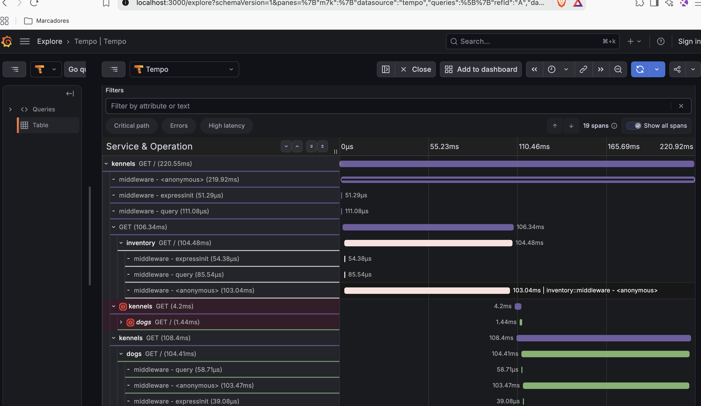
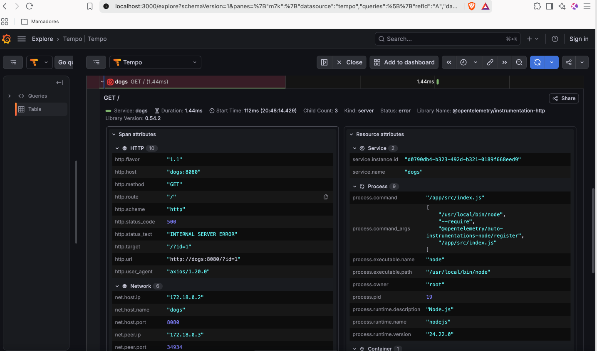
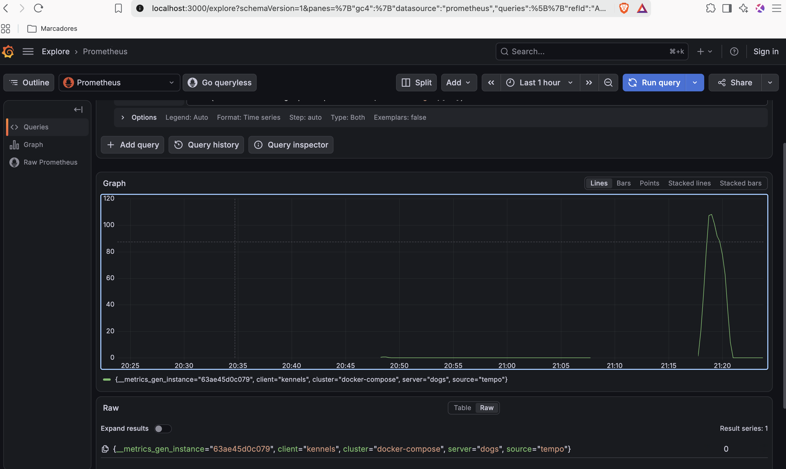

# Memoria Laboratori 8.5 - Distributed Tracing

## ¿De qué trata este laboratorio?

Este laboratorio practica la observabilidad distribuida con el stack `LGTM` de Grafana (`Tempo` + `Prometheus` + `Grafana`) y [OpenTelemetry](https://opentelemetry.io/). Primero se exploran trazas sintéticas generadas con [`xk6-client-tracing`](https://github.com/grafana/xk6-client-tracing) (parte introductoria, no entregable) y después se instrumenta una aplicación real — una API de gestión de perreras (`kennels`) compuesta por tres microservicios Node.js (`kennels`, `dogs`, `inventory`) — con autoinstrumentación de OpenTelemetry, para visualizar sus trazas, el service graph y localizar un error intermitente en el servicio `dogs`.

## Estado de la entrega

| Parte | Estado | Detalle |
|---|---|---|
| Toma de contacto con las trazas (parte 1) | ✅ Realizada (no es entregable) | Stack LGTM + `xk6-client-tracing` desplegado y explorado localmente |
| Stack de observabilidad (Alloy + Tempo + Prometheus + Grafana) | ✅ Completo | `docker-compose.obs.yml`, `obs/config.alloy`, `obs/tempo.yaml`, datasources de Prometheus y Tempo provisionados |
| Instrumentación OpenTelemetry (`kennels` / `dogs` / `inventory`) | ✅ Completo | Autoinstrumentación con `@opentelemetry/auto-instrumentations-node`; trazas visibles en Tempo; service graph muestra `kennels → dogs` y `kennels → inventory` |
| Captura de la traza de error de `dogs` (punto 2.12, entregable) | ✅ Entregado | Ver capturas más abajo |
| Load testing con K6 (puntos 3.1-3.3) | ✅ Completo | Ver análisis y datos más abajo |
| Reto 1 — `node_exporter` + dashboard "Node Exporter Full" | ⏳ Pendiente | — |
| Reto 2 — `blackbox-exporter` + dashboard de sondas HTTP | ⏳ Pendiente | — |

## Instrumentación y traza de error (puntos 2.9 – 2.12)

Se añadieron `@opentelemetry/api` y `@opentelemetry/auto-instrumentations-node` a los tres servicios (`services/*/package.json`), cargando la autoinstrumentación con `node --require @opentelemetry/auto-instrumentations-node/register` en el arranque y configurando en `docker-compose.yml` las variables `OTEL_TRACES_EXPORTER=otlp`, `OTEL_EXPORTER_OTLP_ENDPOINT=http://alloy:4317` y `OTEL_EXPORTER_OTLP_PROTOCOL=grpc` para cada servicio.

El servicio `dogs` falla aleatoriamente (~70% de las peticiones) en su handler `GET /` (`services/dogs/src/index.js`), devolviendo un `500`. Al consultar las trazas en Tempo (Explore → Tempo → TraceQL `{resource.service.name="kennels" && status=error}`) se observa cómo ese error se origina en `dogs` y se propaga hasta la llamada saliente que hace `kennels` al pedirle el nombre de un perro.

**Jerarquía completa de la traza**: se ve la petición raíz `kennels GET /` llamando en paralelo a `inventory` (ok) y dos veces a `dogs` — una de las llamadas (`kennels GET (4.2ms)` → `dogs GET / (1.44ms)`) queda marcada en rojo, mientras que la otra llamada a `dogs` en la misma traza se completa con éxito:

**Detalle del span con el error**: al abrir el span rojo de `dogs` se confirma el fallo exacto — `http.status_code: 500`, `http.target: "/?id=1"`, `Status: error`:

## Load testing (puntos 3.1-3.3)

Se definió `obs/load_test.js` con K6, generando tráfico contra `http://nginx/api/v1/kennels` (3 peticiones por iteración, `id=0,1,2`). Por practicidad se usó una versión reducida del patrón de carga propuesto en el enunciado (rampa de 30s hasta 30 VUs + 2 min sostenido a 15 VUs, en vez de 1 min + 30 min), con la misma metodología. El resultado completo del run y las métricas internas quedan en [`obs/load_test_results.txt`](./obs/load_test_results.txt).

El pico de tráfico generado se aprecia en Prometheus con la query `rate(traces_service_graph_request_total{server="dogs"}[1m])`:

**¿Cuál es el ratio de fallos en el microservicio `dogs`?**
A nivel HTTP externo (lo que ve K6 contra `nginx`/`kennels`), el `http_req_failed` es **0%** — `kennels` absorbe los fallos de `dogs` con un `try/catch` y responde igualmente `200` con `"Nameless Dog"` como fallback (ver `services/kennels/src/data.js`). El fallo real solo es visible a nivel interno: consultando las métricas de service graph que genera Tempo en Prometheus (`traces_service_graph_request_total` / `..._failed_total` con `client="kennels", server="dogs"`), de **13128** llamadas `kennels → dogs` **9262** fallaron, es decir, un **70.55%** — coincide con el `Math.random() < 0.7` inyectado en `services/dogs/src/index.js`. Esto demuestra por qué las trazas distribuidas son necesarias: un fallo de esta magnitud queda completamente oculto si solo se monitoriza el código de estado HTTP de cara al cliente.

**¿Cuántas peticiones por segundo se generaron con K6?**
**43.28 req/s** HTTP (`http_reqs: 6564` en ~2m30s), equivalentes a **14.43 iteraciones/s** (cada iteración hace 3 peticiones), con hasta 30 VUs concurrentes.

**¿Cuál es el cuello de botella de la aplicación?**
Comparando la latencia p95 por servicio (`histogram_quantile(0.95, traces_service_graph_request_server_seconds)`):

| Servicio | p95 |
|---|---|
| `inventory` | 194.6 ms |
| `dogs` | 181.5 ms |
| `kennels` | 379.2 ms |

La p95 de `kennels` (379 ms) es casi exactamente la **suma** de las p95 de `inventory` y `dogs` (195 + 181 ≈ 376 ms), no el máximo de ambas. El motivo está en `services/kennels/src/data.js`: `kennels` primero hace `await getInventory(id)` y **solo después** lanza en paralelo (`Promise.all`) las llamadas a `getDogDetails` por cada perro. Como la llamada a `inventory` bloquea el inicio de las llamadas a `dogs`, la latencia total es aproximadamente aditiva en vez de estar acotada por el servicio más lento. **El cuello de botella es esta orquestación secuencial en `kennels`**, no el rendimiento individual de `dogs` o `inventory` — lanzar ambas llamadas en paralelo reduciría la p95 de ~380 ms a ~195 ms.

## Pendiente

- **Reto 1**: desplegar `node_exporter` (o el exporter integrado de Alloy) y el dashboard "Node Exporter Full" (ID 1860), con captura de pantalla.
- **Reto 2**: desplegar `blackbox-exporter` monitorizando `http://nginx/api/v1/kennels/health` y `https://upcschool.upc.edu`, con su dashboard de sondas y captura de pantalla.
